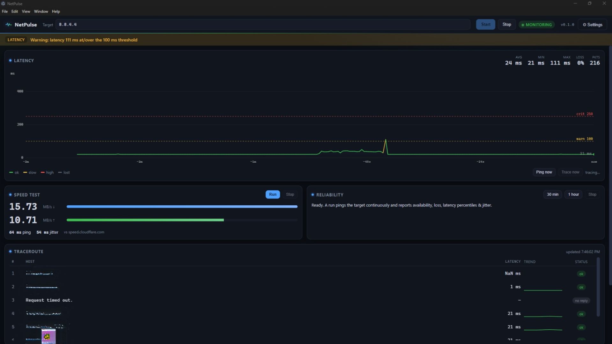

# NetPulse

**A PingPlotter-style network latency & traceroute monitor for Windows** — watch your connection's health roll by in real time, with speed tests and long soak tests to catch the problems your ISP's dashboard hides.


## Why this exists

I'm a freelance computer tech-support specialist, and half my diagnosis calls come down to one question: *is this connection actually bad, or just slow?* I wanted a tool like PingPlotter to answer it visually — but I couldn't afford one. So I tried and tried again, and it took a lot of long back-and-forth sessions with Claude to get there. What grew out of that determination is NetPulse: a tool I built for my own use, and now anyone can grab.

— DoujinMaster401524

## Features

- **Live rolling latency graph** — a scrolling plot of ping RTTs to your target, color-coded by threshold: green is healthy, amber is slow, red is critical; lost packets are marked with a red ×.
- **Traceroute hop view** — runs `tracert` on a timer and shows each hop with per-hop trend sparklines and status chips, so you can see *where* on the path latency or loss lives.
- **Alerts you can actually notice** — a visual banner plus audible (Web Audio) beeps when latency or packet loss breaches your thresholds, and again when things recover.
- **Readouts & event feed** — rolling min/avg/max, loss %, and packet count, with a timestamped feed of alerts, recoveries, and test results.
- **Logging** — a CSV ping log and a traceroute snapshot log are written continuously and can be exported to any folder; everything lives under `%APPDATA%\netpulse\`.
- **Speed test** — download & upload throughput in Mbps plus ping and jitter, measured against a no-key public endpoint (Cloudflare by default), with a live-animated progress UI.
- **Reliability (soak) tests** — one-tap **30 min** and **1 hour** runs that continuously ping a target and produce a report: availability %, packet loss %, latency min/avg/p50/p95/p99, jitter, and an incident timeline. Reports auto-save as JSON + CSV.

## Screenshot

<!-- TODO: replace with a real screenshot of the app, saved at assets/screenshot.png -->



*The main view: rolling latency graph on top, speed test and reliability panels in the middle, traceroute hops and the event log below.*

## Install

### From the installer

Run the installer in `dist\`:

```
dist\NetPulse Setup 0.1.0.exe
```

It's an NSIS installer published by **DoujinMaster401524**. It creates desktop and Start Menu shortcuts, and your settings and logs survive an uninstall because they live in `%APPDATA%\netpulse\`.

### From source

```powershell
npm install
npm start
```

To build the Windows installer yourself:

```powershell
npm run dist:win
```

Output lands in `dist\`.

## How it works

- **Main process does the probing.** The Electron main process shells out to the system `ping` (one packet per tick) and `tracert` (on its own timer); parsing lives in `probe/ping.js` and `probe/tracert.js`, and the engine in `probe/monitor.js` keeps rolling history and raises threshold alerts.
- **Renderer just draws.** The UI (`renderer/`) is a plain web page with canvas graphs — no Node access. A preload script exposes a small, allow-listed `window.netpulse` API over `contextBridge`, so the page can start/stop monitoring and subscribe to probe events.
- **Everything streams over IPC.** Samples, hop updates, alerts, and errors travel down named channels; the renderer keeps a rolling window of samples and redraws as events arrive.
- **Config & logs stay local.** Settings persist to `%APPDATA%\netpulse\config.json`; the ping CSV and traceroute snapshot log write to `%APPDATA%\netpulse\logs\` (they rotate when the target changes).
- **Speed & soak tests are separate engines.** The speed test times HTTPS transfers against the configured server; reliability tests run their own pings in parallel with the live monitor, so you can soak-test without stopping your graph.

## Settings

Everything is tunable from the in-app Settings drawer and saved with the app.

| Setting            | Default                            | What it does |
| ------------------ | ---------------------------------- | ------------ |
| `target`           | `8.8.8.8`                          | Host or IP to monitor |
| `pingIntervalMs`   | `1000`                             | How often a ping sample is taken |
| `pingTimeoutMs`    | `1000`                             | Per-packet timeout |
| `traceIntervalS`   | `30`                               | How often to re-run traceroute (`0` = off) |
| `traceMaxHops`     | `20`                               | Max traceroute hops |
| `resolveHosts`     | `false`                            | Resolve DNS names on hops (slower traces) |
| `warnMs`           | `100`                              | Latency threshold for amber / warning alerts |
| `critMs`           | `250`                              | Latency threshold for red / critical alerts |
| `lossPct`          | `25`                               | Packet-loss threshold (over ~last 10 s) for warnings |
| `soundAlerts`      | `true`                             | Play audible beeps on alerts and recoveries |
| `historySeconds`   | `120`                              | How much rolling history the graph keeps |
| `speedDownloadMB`  | `25`                               | Download size used by the speed test |
| `speedUploadMB`    | `10`                               | Upload size used by the speed test |
| `speedServer`      | `https://speed.cloudflare.com`     | No-key speed-test endpoint |

## Data & privacy

All logs, settings, and reliability reports stay on your machine under `%APPDATA%\netpulse\` — nothing is phoned home. The only web requests the app makes are the speed test, which goes solely to the configured speed server (Cloudflare by default), plus ping/traceroute to your own target.

## Tips

- **Live tuning.** You can change the target, intervals, and thresholds while monitoring — updates apply instantly, no restart needed.
- **Log rotation.** The ping CSV and traceroute log rotate into new files when you switch targets, so each target keeps its own clean history.
- **Speed tests point one way.** The speed test measures against `speed.cloudflare.com`, so results reflect your link to Cloudflare's nearest edge rather than every destination on the internet.
- **Lost hops are normal.** Traceroute hops that don't answer ICMP show up as `*` in the snapshot log; that's typical and doesn't mean the path is broken.

## Limitations / notes

- **Assumes English Windows.** The `ping`/`tracert` parsers are tuned for English output (`time=`, `Lost = 0 (0% loss)`, hop-line shapes). They key on numeric shapes so some localization survives, but this is not guaranteed.
- **`tracert` hops are best-effort.** Some routers don't answer ICMP, and an admin terminal sometimes reveals hops a normal one doesn't — run NetPulse elevated if your trace seems to stop early.
- **Soak tests take as long as they are.** A 1-hour run genuinely takes an hour; it runs in the background for as long as the app is open. Stopping early produces a partial report instead.
- **One instance at a time.** NetPulse takes a single-instance lock — launching a second copy just focuses the open window.

## Project layout

```
main.js                 Electron main: window, IPC, log & report lifecycle
preload.js              contextBridge API (window.netpulse)
config-store.js         settings + defaults, log directory
logger.js               CSV ping log + traceroute snapshot log
probe/ping.js           run + parse Windows ping (single-packet samples)
probe/tracert.js        run + parse Windows tracert (hop lists)
probe/monitor.js        the probe engine (ticks, rolling stats, alerts)
probe/speedtest.js      HTTPS speed test (ping, jitter, down, up)
probe/reliability.js    soak-test engine + report builder
renderer/               index.html, styles.css, graph.js, hops.js, alerts.js, app.js
test/smoke.js           headless probe smoke test (no Electron needed)
```

## Headless probe tests

The probe layer runs standalone, which is handy for a quick command-line check of a target:

```powershell
node test/smoke.js 8.8.8.8
```

## License

MIT — see [LICENSE](LICENSE). © DoujinMaster401524.

Built for one person's workbench; hope it earns a spot on yours.
